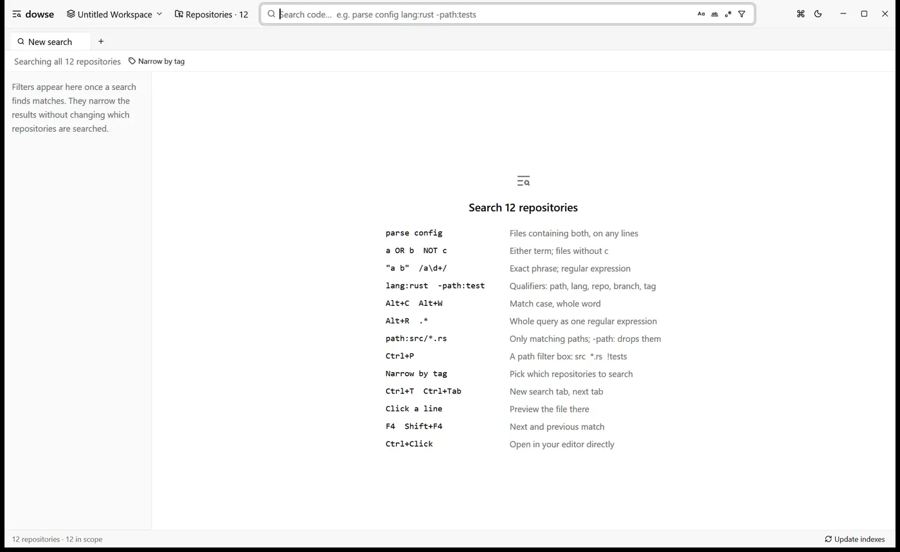
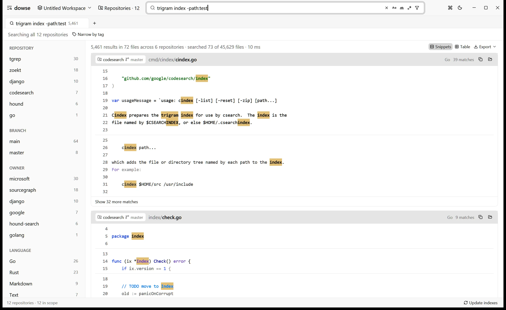
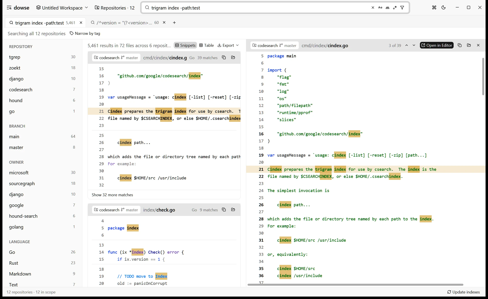
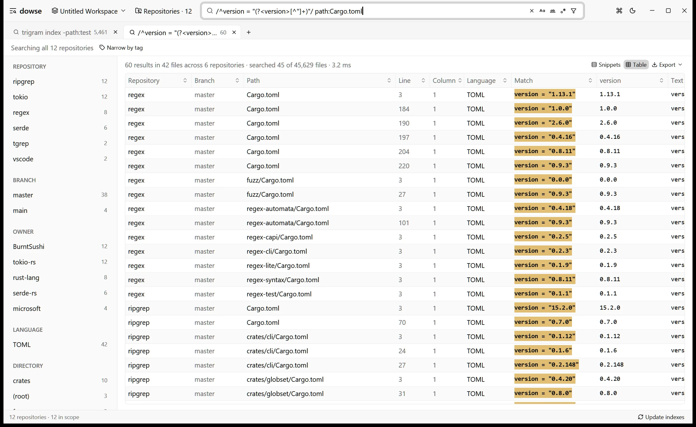
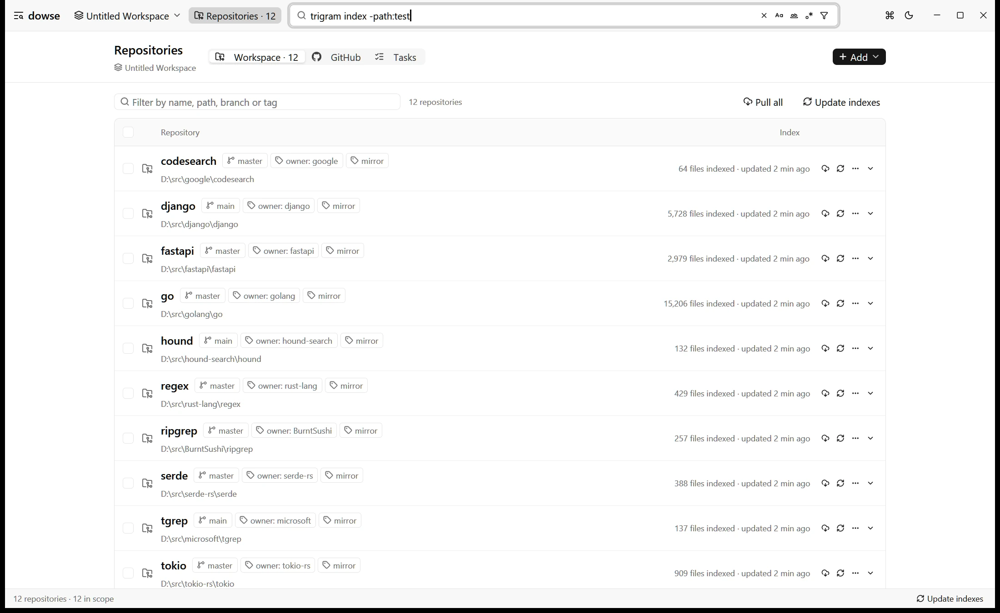

[dowse](https://github.com/HenryZhang-ZHY/dowse) busca código en múltiples repositorios Git a la vez, desde una aplicación de escritorio o desde la línea de comandos. Ofrece para los clones de tu propio disco lo que [GitHub code search](https://github.com/features/code-search) y [grep.app](https://grep.app) hacen en GitHub: un único cuadro de búsqueda, todos tus repositorios y resultados en cuestión de milisegundos. Emplea la misma sintaxis de consulta que GitHub code search, funciona sobre [tgrep](https://github.com/microsoft/tgrep) (el motor grep indexado por trigramas de Microsoft), mantiene un índice por repositorio al estilo de [Zoekt](https://github.com/sourcegraph/zoekt) y no requiere ningún servidor.



dowse funciona en Windows, macOS y Linux. Es gratuito y tiene licencia MIT.

**[Descargar la última versión](https://github.com/HenryZhang-ZHY/dowse/releases)**

## El código que necesitas rara vez está en un solo repositorio

Cuando quieres saber cómo se invoca una función, en qué archivo se lee una clave de configuración o qué microservicios siguen anclados a una versión antigua de una librería, la respuesta suele estar repartida en docenas de repositorios: tus copias de trabajo habituales, las réplicas locales de los servicios de tu equipo y las librerías de las que dependes. Las herramientas habituales solo cubren una parte de esa necesidad:

- **GitHub code search** es rápido y tiene una sintaxis excelente, pero solo busca lo que está alojado en GitHub, se limita a la [rama predeterminada](https://docs.github.com/en/search-github/github-code-search/about-github-code-search#limitations) de cada repositorio y devuelve un máximo de 100 resultados por consulta. La rama de funcionalidad en la que estás trabajando ahora mismo, los cambios locales sin subir y los repositorios alojados en otras plataformas quedan totalmente fuera.
- **grep.app** solo indexa repositorios públicos de GitHub. El código privado de tu empresa no está allí, ni debería estarlo.
- **Sourcegraph** es la plataforma más completa para buscar código, con navegación semántica y cambios masivos (batch changes). Sin embargo, es un sistema basado en servidor: alguien tiene que desplegarlo, conectarlo a los servidores de Git y mantenerlo en funcionamiento. Para una organización de ingeniería grande es una inversión justificada; para un desarrollador en su portátil de trabajo supone demasiada infraestructura solo para consultar unas cuantas carpetas.
- **Zoekt**, el motor de trigramas que impulsa la búsqueda de Sourcegraph, es de código abierto y extremadamente veloz. Pero también es un conjunto de indexadores y servidores que hay que configurar, alimentar y mantener.
- **Entrian Source Search** añade un índice de texto completo dentro de Visual Studio, pero vive encerrado en el IDE y requiere una licencia de pago por desarrollador.
- **ripgrep** y `git grep` no necesitan ninguna configuración previa, pero leen todos los archivos desde el disco en cada búsqueda y solo trabajan en un árbol de directorios a la vez. Al pasar de cincuenta repositorios, la inmediatez desaparece.

Yo quería exactamente la experiencia que ofrece GitHub code search en github.com, pero aplicada a los repositorios de mi propio disco: tanto los mirrors que mantengo sincronizados en `main` como las copias de trabajo en las que desarrollo activamente, con sus modificaciones pendientes de commit incluidas. dowse es esa solución.

## Qué ofrece dowse

### La sintaxis de GitHub code search en tus propios clones locales

Las consultas se analizan en tiempo real a medida que escribes, siguiendo la sintaxis de GitHub code search. Los términos se combinan a nivel de archivo y no de línea individual: por ejemplo, `parse config` busca archivos que contengan ambas palabras en cualquier parte de su contenido y muestra las líneas donde aparece cualquiera de ellas.

```text
parse config                      archivos que contienen ambas palabras
parse OR config                   archivos que contienen cualquiera de ellas
parse NOT test                    contienen parse, pero no test
"fn main()"                       coincidencia exacta del texto
/fn \w+_test/                     línea que coincide con la expresión regular
path:src/*.rs  language:rust      filtro por ruta glob y lenguaje
repo:api  branch:main             repositorios y ramas concretos
-path:tests  -lang:md             exclusiones de búsqueda
```

Si realizas una consulta compuesta solo por calificadores (como `path:*.proto`), dowse lista los archivos coincidentes sin necesidad de leer su contenido. La distinción entre mayúsculas y minúsculas, la coincidencia de palabras completas y las expresiones regulares se alternan al instante mediante atajos de teclado (`Alt+C`, `Alt+W`, `Alt+R`).



Los resultados se muestran en fragmentos con resaltado sintáctico mediante tree-sitter. Al hacer clic en cualquier línea se abre la vista previa del archivo completo junto a los resultados; puedes saltar entre coincidencias con `F4` y abrir el archivo en esa línea exacta en VS Code, Cursor, Zed o Sublime Text con `Ctrl+Click`.



### Las etiquetas definen el alcance; las facetas afinan los resultados

Un espacio de trabajo (workspace) agrupa un conjunto de repositorios, de forma análoga a VS Code, guardado en un archivo `.dowse-workspace`. Cada repositorio puede etiquetarse libremente: etiquetas simples como `mirror` o `dev`, o etiquetas clave-valor como `owner:alice` o `project:billing`. Además, cada repositorio recibe de forma automática la etiqueta `branch:<nombre>` según la rama que tenga activa, actualizándose al cambiar de branch.

La barra de ámbito (scope bar) permite seleccionar las etiquetas sobre las que deseas buscar. Las etiquetas dentro de un mismo grupo funcionan como alternativas OR (`owner:alice` o `owner:bob`); los distintos grupos se combinan mediante AND (`dev` y `owner:alice`). Una vez obtenidos los resultados, las facetas contabilizan las coincidencias por repositorio, rama, etiqueta, lenguaje de programación y directorio raíz, recalculándose bajo el resto de filtros activos igual que en grep.app.

### Vista en tabla: grupos de captura regex convertidos en columnas

La vista en tabla (`Alt+T`) desglosa cada coincidencia en una fila con datos estructurados: repositorio, rama, ruta, línea, columna, lenguaje, texto coincidente y la línea completa. Cuando la expresión regular incluye grupos de captura con nombre (named capture groups), cada grupo se convierte en una columna independiente bautizada con ese nombre. Por ejemplo, esta consulta transforma una búsqueda en una tabla con las versiones de todas las crates en tus repositorios:

```text
/^version = "(?<version>[^"]+)"/ path:Cargo.toml
```



A diferencia de GitHub code search, que se detiene en los primeros 100 resultados, la tabla de dowse admite unas 20.000 filas. Puedes ordenar por cualquier columna, exportar a CSV, TSV, Markdown o JSON, o copiar y pegar directamente en una hoja de cálculo. Preguntas habituales como "¿qué servicios siguen llamando a esta API obsoleta?" o "¿qué niveles de log hay configurados en cada sitio?" se resuelven en una tabla ordenada sin necesidad de revisar manualmente cientos de coincidencias.

### Clona organizaciones enteras de GitHub y mantenlas al día

La pestaña de repositorios lista los repositorios de un usuario u organización mediante el [GitHub CLI](https://cli.github.com), por lo que dowse nunca manipula tus credenciales: basta con haber ejecutado `gh auth login` en la terminal. La paginación se recupera en paralelo; una organización con 2.000 repositorios se lista en cuestión de segundos. Elige algunos o todos los repositorios mostrados y dowse los clonará en segundo plano en `<carpeta>/<owner>/<name>`, asignándoles la etiqueta `owner:<owner>` e indexándolos de inmediato.

Por defecto, los clones se realizan en modo sin blobs (blobless clones): descargan todo el historial de commits, pero solo el contenido de los archivos de la revisión activa. De este modo, los repositorios voluminosos se clonan en un instante y el historial de Git sigue funcionando con total normalidad.



Si asignas un intervalo de sincronización a un repositorio (`15m`, `1h`, `3d`), dowse ejecutará un pull programado. Esta operación hace un fetch de `origin` y solo aplica fast-forward si se cumplen todas las condiciones de seguridad: está activa la rama predeterminada, no hay archivos modificados y no existen commits locales pendientes de subir. De lo contrario, se limita a hacer fetch e informa con claridad del motivo (`on feature/x, not main`, `uncommitted changes`). Jamás realiza merge, rebase ni stash de forma automática, por lo que es completamente seguro utilizarlo tanto en mirrors como en tus copias de desarrollo diario.

## Impulsado por tgrep, el grep por trigramas de Microsoft

El motor interno de dowse es [tgrep](https://github.com/microsoft/tgrep), la herramienta de búsqueda indexada por trigramas que Microsoft publicó este año como código abierto y que da soporte a las búsquedas de código en [GitHub Copilot CLI](https://github.com/github/copilot-cli). Un índice de trigramas registra qué archivos contienen cada secuencia de tres caracteres; cuando introduces una consulta, tgrep la descompone en trigramas, calcula la intersección de sus listas invertidas y solo lee del disco aquellos archivos que tienen posibilidades matemáticas de coincidir, pasándoselos después al motor regex real. Zoekt y el histórico [Google Code Search](https://swtch.com/~rsc/regexp/regexp4.html) se basan en este mismo principio. En los benchmarks oficiales de Microsoft, tgrep superó a ripgrep en 17 de las 18 combinaciones de repositorios y plataformas analizadas, logrando mejoras de hasta 51,9 veces.

Para las capturas que ilustran este artículo, dowse indexa doce repositorios públicos clonados de GitHub: tgrep, ripgrep, Zoekt, Google codesearch, Hound, tokio, serde, regex, VS Code, Django, FastAPI y Go, con un total de 45.629 archivos. La consulta `trigram index -path:test` coincide con 72 archivos repartidos en seis repositorios; para localizarlos, dowse solo tuvo que leer 73 archivos del disco y tardó 10 ms. Generar la tabla de versiones de Cargo.toml tomó apenas 3,2 ms. En un árbol de código aún mayor con 42.000 archivos (1,3 GB de código fuente en Rust), el índice se genera en unos 6 segundos y las búsquedas habituales se completan en 20–60 ms.

tgrep como herramienta independiente está pensado para indexar un único árbol de directorios y consultarlo por CLI o mediante un servidor dedicado. dowse sitúa múltiples árboles de código tras un único cuadro de búsqueda y aporta todo lo necesario para esa escala: compatibilidad con la sintaxis de GitHub, etiquetas y facetas entre repositorios, vista en tabla, previsualización de archivos, y clonado y sincronización directa con GitHub. Los índices son nativos de tgrep y residen en la carpeta `.tgrep` de cada repositorio (la misma ruta que emplean `tgrep index` y `tgrep serve`), lo que permite que dowse y la CLI de tgrep compartan un único índice por proyecto.

## Un índice siempre actualizado sin reconstrucciones completas

Un índice solo es útil si coincide con los archivos del disco, de modo que dowse no necesita reconstrucciones completas para detectar los cambios:

- Un monitor de archivos (file watcher) en cada repositorio registra los archivos modificados desde la última compilación del índice, y las búsquedas los leen directamente. Cualquier `git pull` en un mirror o una edición guardada hace un segundo aparece en la siguiente búsqueda.
- Al abrir un repositorio, dowse detecta automáticamente los archivos añadidos, eliminados o renombrados mientras la aplicación estaba cerrada.
- La actualización del índice solo procesa los archivos que han cambiado y los transmite en streaming hacia una copia del índice. En un repositorio de 245.000 archivos con un índice de 1,7 GB, la actualización tarda unos 10 segundos, frente a los 9 minutos que requeriría una reconstrucción desde cero. Además, las búsquedas siguen funcionando con total normalidad mientras el proceso se ejecuta.

La interfaz de escritorio es nativa, desarrollada con [GPUI](https://github.com/zed-industries/zed), el framework renderizado por GPU que da vida al editor Zed. No hay navegadores web ni capas de Electron de por medio.

## Una línea de comandos para personas y agentes de programación

Los comandos de terminal como `dowse search` o `dowse repos` interactúan con la aplicación de escritorio en ejecución, aprovechando sus índices cargados en memoria y sus monitores de archivos activos. Si la aplicación de escritorio no está abierta, el primer comando la inicia en segundo plano de manera silenciosa, sin ventanas.

```bash
dowse search 'parse_config lang:rust'          # busca en todos los repositorios gestionados
dowse search --here 'parse_config'             # busca únicamente en el repositorio actual
dowse search -t owner:my-org -l 'LegacyClient' # solo rutas de archivos, filtrando por organización
dowse repos clone --from my-org --pull-every 1h
```

La salida de la terminal está optimizada tanto para humanos como para agentes de IA como Claude Code, Codex o Cursor. Cuando un agente ejecuta `grep` en un repositorio extenso, pierde la mayor parte del tiempo en operaciones de entrada/salida y satura rápidamente su ventana de contexto con salidas kilométricas. tgrep resuelve la primera mitad del problema dentro de GitHub Copilot CLI; dowse ofrece a cualquier agente el mismo índice ultraveloz para todos tus repositorios locales, gestionando con precisión el consumo de tokens:

- Los resultados se imprimen en stdout; los recuentos, tiempos y notas de contexto van a stderr. El código de salida es 0 si hubo coincidencias y 1 si no se encontró nada.
- La salida está limitada por defecto a 100 líneas coincidentes y un máximo de 20 por archivo, con un resumen al pie. Si los resultados se truncan, el pie sugiere calificadores específicos para acotar la búsqueda, indicando cuántos archivos coincidirían con cada uno:

  ```text
  narrow with: repo:api (120)  language:Rust (80)  path:src/** (64)
  ```

- `--json` imprime un objeto por cada archivo coincidente junto a un resumen; `--table csv` exporta las filas de la vista en tabla directamente como CSV.
- `dowse guide` muestra [una guía concisa pensada para agentes](https://github.com/HenryZhang-ZHY/dowse/blob/master/docs/agent-guide.md). Si la incluyes en tu `AGENTS.md` o `CLAUDE.md`, el agente podrá buscar en todos tus repositorios locales y no solo en el directorio donde fue invocado.

## Comparativa de dowse con tgrep, Sourcegraph, Zoekt, GitHub code search y Entrian Source Search

| Característica    | dowse                                                        | tgrep                 | GitHub code search                        | Sourcegraph                  | Zoekt                     | Entrian Source Search              |
| ----------------- | ------------------------------------------------------------ | --------------------- | ----------------------------------------- | ---------------------------- | ------------------------- | ---------------------------------- |
| Dónde se ejecuta  | En tu máquina                                                | En tu máquina         | En github.com                             | Servidor propio              | Servidor propio           | Dentro de Visual Studio            |
| Alcance           | Múltiples clones locales, cualquier rama, cambios sin commit | Un único árbol        | Repositorios de GitHub, solo rama default | Servidores de Git conectados | Repositorios que indiques | Archivos de la solución actual     |
| Sintaxis          | GitHub code search                                           | Regex, estilo grep    | GitHub code search                        | Sourcegraph                  | Zoekt                     | Sintaxis de Entrian                |
| Índice            | Trigramas (tgrep), actualizado por watcher                   | Trigramas             | Propietario de GitHub                     | Zoekt                        | Trigramas                 | Texto completo                     |
| Interfaz          | App de escritorio y CLI                                      | CLI y servidor ligero | Web                                       | Web                          | Web y API                 | Panel del IDE                      |
| Precio y licencia | Gratuito, MIT                                                | Gratuito, MIT         | Incluido en GitHub                        | Comercial                    | Gratuito, Apache-2.0      | Licencia de pago por desarrollador |

En resumen: si buscas la forma más rápida de hacer grep en un único repositorio desde la terminal, tgrep es insuperable. Si tu equipo necesita un buscador corporativo accesible por navegador, Sourcegraph o una instancia de Zoekt son la solución adecuada. Si todo tu código vive en GitHub y te basta con la rama principal, ya cuentas con GitHub code search. Y si quieres buscar al instante en todos los repositorios de tu propio equipo, en cualquier rama, con cambios sin commitear y sin desplegar ningún servidor, tanto en tu escritorio como desde el terminal de tu agente de IA, dowse se ha creado exactamente para ti.

## Descarga dowse

La [página de lanzamientos](https://github.com/HenryZhang-ZHY/dowse/releases) dispone siempre de las compilaciones más recientes listas para usar, con sus correspondientes sumas de verificación en `SHA256SUMS`. Cada archivo sigue la convención `dowse`, la versión y tu sistema operativo:

| Plataforma                        | Archivo                  |
| --------------------------------- | ------------------------ |
| Windows (x64)                     | `…-windows-x86_64.zip`   |
| macOS 11+ (Apple silicon e Intel) | `…-macos-universal.zip`  |
| Linux (x64)                       | `…-linux-x86_64.tar.gz`  |
| Linux (arm64)                     | `…-linux-aarch64.tar.gz` |

Tras descomprimir la aplicación, añade las carpetas donde guardas tus repositorios:

```bash
dowse ~/src ~/mirrors
```

Si una carpeta contiene varios repositorios Git, dowse los incorporará todos automáticamente. En Windows, la pantalla de repositorios permite además añadir la opción "Add to dowse" al menú contextual de carpetas en el Explorador de archivos.

Dado que los binarios no están firmados con un certificado comercial de pago, Windows SmartScreen o macOS Gatekeeper pueden mostrar un aviso preventivo la primera vez que se ejecuten; en el [README](https://github.com/HenryZhang-ZHY/dowse#download) se detalla cómo autorizar la apertura. Para compilar directamente desde el código fuente, basta con ejecutar `cargo run --release` con una versión reciente y estable de Rust.

## Preguntas frecuentes (FAQ)

### ¿Es dowse una alternativa a Sourcegraph?

Para un desarrollador individual que busca en sus propios clones locales, sí. dowse cubre el caso de uso fundamental de Sourcegraph: búsquedas ultrarrápidas literales y por expresiones regulares a través de múltiples repositorios, sin necesidad de infraestructura de servidor. No sustituye la navegación de código semántica (code intelligence), los cambios por lotes (batch changes) ni la interfaz web colaborativa pensada para equipos.

### ¿Es dowse simplemente una interfaz gráfica para tgrep?

En parte. dowse utiliza el motor de índices de tgrep y lee y escribe en las mismas carpetas `.tgrep`, por lo que sirve como cliente de escritorio para tgrep. No obstante, dowse permite buscar en decenas de repositorios con una sola consulta, procesa la sintaxis de búsqueda de GitHub y añade etiquetas, facetas, vista en tabla, previsualización de archivos, y clonado y sincronización con GitHub, funcionalidades que quedan fuera del alcance de tgrep.

### ¿En qué se diferencia dowse de Zoekt?

Ambos se basan en índices invertidos de trigramas. Zoekt está concebido como un servicio de fondo que debe mantenerse activo y recibir índices generados externamente; dowse es una aplicación autónoma que indexa directamente los repositorios de tu disco, los mantiene al día mediante monitores de archivos y actualizaciones incrementales, y ofrece una interfaz de escritorio cuidada junto con una potente CLI.

### ¿Puedo buscar en local utilizando la sintaxis de GitHub code search?

Sí. dowse reconoce los elementos principales de la sintaxis de GitHub code search: operadores `AND`, `OR`, `NOT`, texto exacto entre comillas, expresiones regulares con `/regex/`, y los calificadores `path:`, `language:`, `repo:` y `branch:`, admitiendo el prefijo `-` para negaciones.

### ¿dowse incluye cambios sin commitear y ramas distintas a la principal?

Sí. Al leer directamente los archivos en disco, busca exactamente en el estado en que se encuentre cada repositorio, incluyendo las modificaciones no confirmadas. Como cada repositorio se etiqueta con su rama activa, con `branch:main` puedes restringir la búsqueda a las ramas principales cuando lo desees.

### ¿Existe alguna alternativa a Entrian Source Search que no dependa de Visual Studio?

dowse no es un complemento para ningún IDE específico, sino una aplicación independiente y CLI que abre los resultados directamente en tu editor habitual, ya sea VS Code, Cursor, Zed o Sublime Text. Busca en múltiples repositorios sin limitarse a una solución concreta y es completamente libre y gratuita.

### ¿dowse envía mi código a algún servidor externo?

No. Los índices se almacenan localmente en la carpeta `.tgrep` de cada repositorio y las consultas se resuelven íntegramente en tu máquina. La única actividad de red que realiza dowse corresponde a las operaciones de Git y del GitHub CLI que solicites de forma explícita, como listar repositorios de una organización, clonarlos o sincronizarlos en segundo plano.

---

dowse está publicado en [GitHub](https://github.com/HenryZhang-ZHY/dowse). Si te ayuda a ahorrar tiempo en tu día a día, una estrella en el repositorio ayudará a que otros desarrolladores lo descubran; si detectas algún problema o echas en falta alguna función, puedes [abrir una incidencia](https://github.com/HenryZhang-ZHY/dowse/issues).
