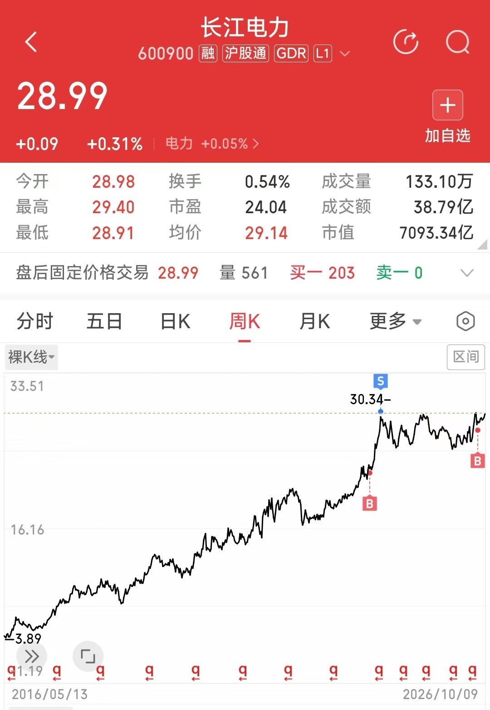

> **声明**：本文是个人学习和投资思考的记录，不构成投资建议。文中提到的长江电力只作举例，不代表推荐买入。投资有风险，请独立判断。

> 投资的大道很简单：用**不贵的价格**买**好资产**，**持有足够长的时间**，赚取**合理的收益**。

不少人把钱放在收益很低、甚至十几年取不出来的保本产品里，只是因为受不了二级市场的账面波动。但价格波动不等于永久亏损。只要理解资产本身的价值，再用“仓位管理”控制回撤对总资产的影响，波动就没那么难熬，有时还能帮你降低持仓成本。

## 一、为什么好资产也会让人拿不住：回撤放大了心理痛苦

选对股票，决定了长期能不能赚到钱；仓位管理，决定了你在波动中能不能拿得住。

以常被视为“类债股”的长江电力为例：2016 年到 2026 年，算上分红再投入，它累计涨了 2 倍多，年化收益约 11%。但就是这样一只股票，按月末收盘价算，中途最大回撤约 15.5%；如果看高点到盘中最低点，跌幅接近 20%。

面对这样的回撤，很少有人能毫不在意。看着账户一天天缩水，你会开始怀疑公司的基本面，怀疑自己的判断，犹豫要不要先卖掉躲一躲回撤。

股票跌多少，个人控制不了。但这个跌幅落到你的总账户上有多大，是可以提前控制的。

## 二、降低回撤：给单只股票设仓位上限

没人能预测未来的涨跌，所以要控制回撤对心理的冲击，最简单的办法是控制仓位。算式很朴素：

$$\text{个股回撤对总账户的冲击} = \text{个股跌幅} \times \text{该股占总资金的比例}$$

假设家庭可投资资产是 100 万元，对比两种做法：

- **做法 A：全部买入（100% 仓位）**  
  100 万元全部买入长江电力。股价回撤 10%，账户少了 **10 万元**；遇到接近 20% 的深度回撤，账面亏损接近 **20 万元**。这个数字足以影响一个家庭的生活和情绪，很多人就是在这时扛不住，在低位卖出。
- **做法 B：单只股票不超过 20%**  
  给自己定一条规矩：任何一只股票，买入金额都不超过总资金的 20%，也就是 20 万元。剩下 80 万元放在其他资产里，比如别的股票、债券、存款或货币基金，具体比例按自己的风险承受能力来定。  
  这时长江电力同样下跌 10%，这部分亏损 2 万元，落到 100 万元的总账户上，**总回撤是 2%**；即使遇到接近 20% 的深度回撤，亏损约 4 万元，**总回撤约 4%**。

股票还是那只股票，跌幅也没变，但落到总账户上只有 2% 到 4%。大多数人能承受这个幅度，也就更容易拿得住。

这样做也有代价。只买 20%，这只股票上涨时带给总账户的收益，也只有全仓时的五分之一。仓位上限换来的是更平稳的持有过程。

还有一点要分清：20% 上限管的是**单一公司的风险**。假如剩下 80 万元也全部买了股票，单只股票出问题的影响虽然被分散了，但遇到整个市场一起下跌，总账户的回撤仍然会明显大于 4%。所以股票和稳健资产怎么搭配，是在单支股票仓位上限之外要单独考虑的问题。好在这不是二选一：不必全仓股票，也不必把钱全部锁进保本产品。

### 政府产业基金也给单个项目设上限

有人可能会想：20% 是不是太保守了？好不容易挑到一只很看好的股票，为什么不多买一点？

可以看看专业机构是怎么管钱的。国家发展改革委印发的[《政府出资产业投资基金管理暂行办法》](https://www.ndrc.gov.cn/xxgk/zcfb/ghxwj/202006/t20200616_1231357.html)第二十六条规定：

> “政府出资产业投资基金对单个企业的投资额不得超过基金资产总值的 20%。”

合肥这些年因为投中京东方、长鑫存储、蔚来汽车，被不少人称为“最牛风投城市”，外界印象是敢下重注。这几笔有名的投资，很多是市属国资平台牵头的城市级产业决策，投入规模也很大。但在日常运作的基金层面，[《合肥市产业投资引导基金管理办法》](https://f.qianzhan.com/chanyeguihua/detail/210914-766cae6d.html)第二十三条规定：

> “引导基金对单个企业的投资额原则上不得超过基金资产总值的20%。”

这类规定的本意是分散：单个企业不超过 20%，其余资金投向别的企业，以免一个项目失败拖垮整只基金。有专业团队、能调动大量资源的机构，管理基金时也要先给单个项目定上限。普通家庭的钱更输不起，更没有理由把全部积蓄押在一只股票上。

这是仓位管理的第一步：不需要预测市场的短期顶底，只要给单只股票定好上限，就能把单一资产大跌对心态和家庭财务的冲击控制在可承受的范围内。

---

## 三、利用回撤：分批建仓，给下跌留一份预案

有了 20% 的上限，还可以再进一步：**不一次性把 20% 买满**。

### 1. 先买一半

同样是 100 万元资金，你给长江电力定的上限是 20 万元。进场时先只买一半，也就是 **10 万元**，占总资金 10%。

假设买入价是 10 元/股，买入 10,000 股。

如果买入后股价回调 10%，从 10 元跌到 9 元：

- 这 10 万元浮亏 **1 万元**；
- 落到 100 万元的总账户上，**总回撤只有 1%**。

1% 的波动对家庭资产影响很小。而且你手里还有计划好的 10 万元，下跌对你来说是执行计划的时候，不只是干等。

### 2. 跌 10% 时补上另一半

按照事先定好的计划，股价跌到 9 元时，把剩下的 10 万元买进去：

- 在 9 元，10 万元可以买约 **11,111 股**，比在 10 元时多买约 1,111 股；
- 这时持仓总额达到 20 万元的上限，合计约 **21,111 股**；
- 平均持仓成本降到：
  $$200,000 \div 21,111.11 \approx 9.47 \text{ 元}$$

### 3. 股价回到 10 元时

如果之后股价慢慢涨回最初的 10 元：

- **一次性买满 20 万元**：9 元时浮亏 2 万元，回到 10 元刚好回本；
- **分批买入**：持仓市值是
  $$21,111.11 \text{ 股} \times 10 \text{ 元} \approx 21.11 \text{ 万元}$$
  总成本 20 万元，**盈利约 1.11 万元，相当于这 20 万元多赚了约 5.6%**。

股价只是回到原点，分批买入的人已经有了盈利，持有期间还能照常领取分红。

### 4. 股价不一定按这个剧本走

上面是对分批买入最有利的一种走势。换几种走势，结果就不一样：

- **买完一半后一直上涨**：比如从 10 元直接涨到 12 元，没有回到 9 元。一次性买满的人赚 4 万元，分批买入的人只赚 2 万元，另一半资金一直闲着。长江电力过去十年整体是上涨的，这种情况并不少见。所以最好事先想好：如果迟迟等不到回调，剩下的钱在什么时候、按什么条件买进去。
- **跌到 9 元后继续下跌**：比如跌到 8 元，两种做法都亏。一次性买满亏 4 万元，分批买入亏约 3.1 万元，只是亏得少一些。

所以分批建仓不是稳赚的技巧。它的真正作用是：下跌时你手里有钱、有计划，不容易慌，也就不容易在低位卖掉好资产。代价是，如果股价一路上涨，你会少赚一些。

---

## 四、补仓前先定好的三条规矩

分批买入能让下跌变得好熬一些。但现实中不少人越补越套，问题往往出在没有事先定好规矩。补仓之前，至少要想清楚三件事：

1. **单只股票的总仓位上限不能突破**  
   给长江电力定了 20% 的上限，两批买完（达到 20 万元）就停手。股价跌到 8 元、7 元，也不动用生活资金继续补仓，不能让一只股票影响整个家庭的财务安全。
2. **补仓的间隔提前定好**  
   补仓是按计划执行，不是跌一点就买一点。比如事先定好回撤 10% 才补第二笔，没到这个位置就不动手，避免跌了 2% 到 3% 就频繁加仓，把后手资金提前用完。波动大的标的，补仓间隔也要相应拉长。
3. **基本面没变才补，变了就不补**  
   补仓的前提是这家公司有长期稳定的盈利和分红能力。如果行业被颠覆、公司治理出了问题，或者盈利能力长期变差，就不再补仓，而是重新审视当初买入的理由。
4. **不借钱、不加杠杆补仓**  
   仓位管理规则和资产配置规则是为了反脆弱，杠杆会增加脆弱性。

---

## 五、总结：仓位管理改善的是持有体验

把上面的内容串起来，普通人应对市场波动可以分三步：

1. **降低回撤**：给单只股票设定仓位上限（比如 20%），一只股票大跌时，总账户的回撤仍在自己能承受的范围内；
2. **利用回撤**：不一次性买满，先买一部分仓位，剩下的仓位按事先定好的条件在回调时买入，代价是上涨时可能少赚一些；
3. **与回撤共舞**：守住仓位上限和补仓规矩，让下跌成为执行计划的机会，避免恐慌卖出优质筹码。

明天市场是涨是跌，下一次回撤什么时候来，都没人能预知。仓位管理不能让你多赚更多钱，但它能让一只股票下跌时，你的总账户仍然稳得住；手里留有计划内的资金，回调时可以按规则补仓；整个过程不被情绪支配，不被短期波动左右。

能拿得住好资产，穿越一轮又一轮的波动，长期收益才有机会兑现。
